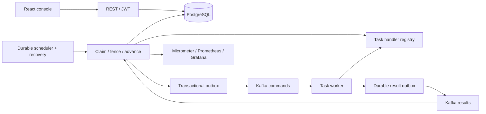

# Architecture

## Modules and dependency direction
`definition` owns immutable JSON definitions and validation. `execution` owns runs, task state and lifecycle controls. `engine` coordinates claim → invoke → complete through a pluggable `TaskHandler` registry. `retry` calculates persisted due times. `recovery` fences and reschedules expired leases. `scheduling` scans due work and recurring workflow starts. `messaging` owns versioned Kafka envelopes and outbox publication. `persistence` owns JPA entities/repositories and PostgreSQL queries. `security` owns users/JWT/roles. `observability` owns correlation and metrics. `api` translates DTOs and errors. Business examples live in `task` and are never selected by conditionals in the engine.

## Durable execution
A run snapshots a definition ID/version; tasks are initialized PENDING. A scheduler locks an eligible execution and claims one task, increments its attempt, assigns a random lease token and database-derived expiry, then commits. A local worker invokes the handler outside that transaction. A Kafka run instead writes a command to the outbox in that transaction. Completion locks the execution and task and verifies status, lease token and expiry. It persists output/event and advances exactly one successor atomically. Completed tasks are not selected again.

Leases are bounded attempt deadlines, not heartbeats. A handler must finish inside the configured lease; long workflows can contain many tasks and durable retry waits. Individual hours-long handlers need a heartbeat/checkpoint extension (future work). Expired attempts are recovered to RETRY_WAIT or FAILED according to policy. Fencing rejects late/stale results. Workers must honor external timeouts and stable idempotency keys; interrupting a Java thread is not a guarantee that a remote side effect stopped.

## States
Workflow: CREATED → RUNNING → COMPLETED / FAILED; RUNNING → PAUSED → RUNNING; FAILED → RUNNING on manual retry; CREATED/RUNNING/PAUSED/FAILED → CANCELLING → CANCELLED. A task may finish while paused, but the next task cannot start. Task: PENDING → RUNNING → COMPLETED / RETRY_WAIT / FAILED; RETRY_WAIT → RUNNING; FAILED → RETRY_WAIT on manual retry; pending/running/retry/failed → CANCELLED. Terminal completions remain immutable.

## Idempotency and external effects
Task key = workflow execution UUID + task name, stable across attempts. Simulated payment/inventory/notification services persist an idempotency record and simulated result in one database transaction, using a transaction-scoped advisory lock per key. A real provider must implement the same key contract and lookup/reconciliation on uncertain timeout. Local transaction commit cannot atomically commit arbitrary remote effects. Delivery and invocation are at least once; acknowledged state advancement is fenced and atomic.

## Kafka failure model
Outbox rows are inserted with business state, published with broker acknowledgement, then marked sent. A crash after send before mark causes duplicates. Commands carry event version, event UUID, run/task IDs, attempt token and correlation ID. Workers deduplicate result persistence per token; external effects use the stable task key. Result ingestion rejects stale tokens. Invalid/poison records route to a dead-letter topic with bounded broker redelivery. Business retries use PostgreSQL due times, not sleeping consumers. Permanent business failures also emit DLT events.

## Coordination, security and boundaries
PostgreSQL row locks and lease fencing coordinate replicas. Redis is supplied for optional future cache/rate limiting; correctness does not depend on Redis locks. JWT is signed with an environment secret, limited lifetime, subject/roles; BCrypt hashes passwords. Bootstrap admin comes only from environment. Registration is not public; admins provision USER accounts. All users share one operational workspace (no multitenancy). Users may observe/start/control runs; ADMIN manages definitions/schedules/users. Actuator uses a separate management listener on port 9091. Health and Prometheus scrape are available there; it binds loopback locally and is not host-published by Compose. Other management endpoints require ADMIN. Public application port 8080 does not expose the scrape endpoint.
