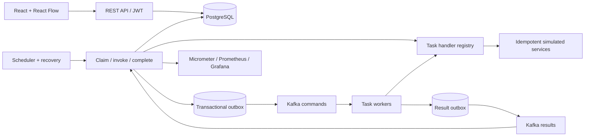
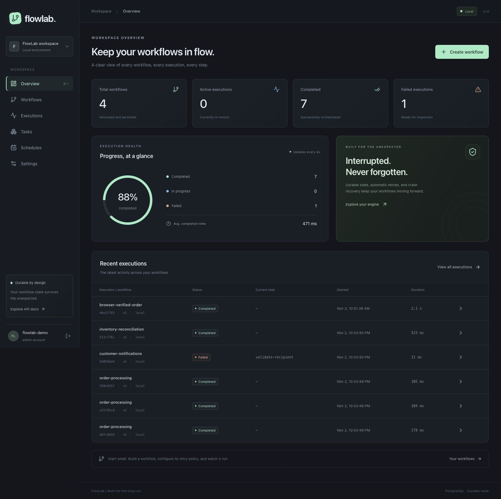

# FlowLab

**A lightweight, durable workflow engine you can read, run, break, and understand.**

FlowLab is a Java 21 / Spring Boot 3 modular monolith for sequential workflow orchestration, with PostgreSQL state, lease-based crash recovery, durable retries, optional Kafka workers, and a React operations console. It demonstrates the mechanics behind platforms such as Camunda without pretending to replace their production feature sets.

## Why this exists

A process that validates an order, charges a provider, updates inventory, and sends a notification must not forget its progress when a process dies. Keeping that progress only in memory, retrying an entire chain, or sending Kafka messages after a database commit without an outbox leaves dangerous failure windows. FlowLab makes these windows explicit and tests the important ones.

## Features

- Immutable, validated JSON workflow versions with activation/deactivation.
- Sequential task execution through a typed handler registry; no business branching inside the engine.
- PostgreSQL JSONB persistence and Flyway migrations; transactional task advancement.
- Expiring execution leases, token-fenced completion, concurrent claims using `SKIP LOCKED`.
- Durable exponential retries, permanent failures, manual retry, pause/resume/cancel.
- Stable business idempotency keys and simulated payment/inventory/notification providers.
- Kafka command/result topics, consumer groups, transactional outbox, deduplication and dead letters.
- JWT authentication, BCrypt password hashes, ADMIN/USER authorization and admin-managed accounts.
- Dark React console: overview, searchable workflows, React Flow designer, executions, task timeline, audit events, schedules and settings. All operational data comes from backend APIs.
- Database-backed interval schedules, structured logs, correlation IDs, Prometheus metrics and Grafana dashboard.
- Real PostgreSQL/Kafka integration tests, Docker Compose and CI.

## Architecture



The packages under `src/main/java/io/flowlab` separate definitions, execution lifecycle, engine, task handlers, retries, recovery, scheduling, messaging, persistence, security, observability and HTTP APIs. There is one deployable backend. PostgreSQL is the coordination authority; Redis is available in Compose but intentionally not used as a competing lock authority.

See [ARCHITECTURE.md](ARCHITECTURE.md), [DATABASE_DESIGN.md](DATABASE_DESIGN.md), [API_SPECIFICATION.md](API_SPECIFICATION.md), [PLAN.md](PLAN.md) and [DEVELOPMENT_ROADMAP.md](DEVELOPMENT_ROADMAP.md).

## Stack and compatibility

Java 21; Spring Boot 3.5; Maven Wrapper; Spring Web/Data JPA/Validation/Security; OAuth2 Resource Server JWT; Spring Kafka; PostgreSQL; Flyway; Actuator/Micrometer. Frontend: React 19, TypeScript, Vite 7, Tailwind 4, React Flow 12, Axios, React Router 7. Infrastructure: PostgreSQL 16, Kafka 3.9 KRaft, Redis 7.4, Prometheus and Grafana. Exact pins and compatibility sources are in [docs/DEPENDENCIES.md](docs/DEPENDENCIES.md).

## Quick start with Docker

Requirements: Docker Engine/Desktop with Compose v2, at least 4 GB available RAM (6 GB recommended for the complete monitoring stack).

```sh
./scripts/init-env.sh
# Inspect .env locally for generated ADMIN_USERNAME / ADMIN_PASSWORD.
docker compose up --build --wait
```

The secret initializer generates random passwords and a JWT secret, refuses to overwrite an existing `.env`, and keeps it ignored by Git. There are no default application credentials. Alternatively copy `.env.example` to `.env` and fill every required value yourself.

| Service | Address |
|---|---|
| Console | http://localhost:3000 |
| REST API | http://localhost:8080/api/v1 |
| Swagger UI | http://localhost:8080/swagger-ui/index.html |
| OpenAPI JSON | http://localhost:8080/v3/api-docs |
| Prometheus | http://localhost:9090 |
| Grafana | http://localhost:3001 |

Log into FlowLab with the generated admin account. Grafana uses the same configured username and its separate `GRAFANA_ADMIN_PASSWORD`. The Grafana data source and engine dashboard are provisioned automatically. Initially, the console is empty; create your first workflow or use the example below. No fake execution data is inserted by normal startup.

Database and broker data live in named Docker volumes. `docker compose restart backend` preserves them. `docker compose down` preserves them. **`docker compose down -v` removes them** and is only appropriate for disposable environments.

Compose binds host ports to loopback. The management listener on port 9091 is available only inside the Docker network; Prometheus scrapes it there. Redis has no host port. This is a local development deployment, without external TLS or a replicated Kafka cluster.

## Run from source

Requirements: JDK 21, Node 22.12+, pnpm 10.17.1, Docker for infrastructure (or your own PostgreSQL/Kafka).

```sh
./scripts/init-env.sh
set -a
. ./.env
set +a
docker compose up -d postgres kafka redis
./mvnw spring-boot:run
```

In another terminal:

```sh
cd frontend
corepack enable
pnpm install --frozen-lockfile
pnpm dev
```

Open http://localhost:5173. Vite proxies API calls to port 8080. Export `KAFKA_ENABLED=false` to run only local workers. The backend always requires PostgreSQL. Set `DATABASE_URL`, `DATABASE_USER`, `DATABASE_PASSWORD`, `JWT_SECRET` and bootstrap `ADMIN_USERNAME`/`ADMIN_PASSWORD` when using external infrastructure.

Useful configuration:

| Variable | Default / requirement |
|---|---|
| DATABASE_URL | `jdbc:postgresql://localhost:5432/flowlab` |
| DATABASE_USER | `flowlab` |
| DATABASE_PASSWORD | Required |
| JWT_SECRET | Required, at least 32 bytes |
| ADMIN_USERNAME / ADMIN_PASSWORD | Optional bootstrap; password at least 12 characters and at most 72 UTF-8 bytes |
| KAFKA_ENABLED | false outside Compose |
| KAFKA_BOOTSTRAP_SERVERS | localhost:9092 |
| TASK_LEASE_SECONDS | 30 |
| WORKER_CONCURRENCY | 8 (1–100) |
| SCHEDULER_ENABLED | true |
| ALLOWED_ORIGINS | localhost:5173 and localhost:3000 |
| MANAGEMENT_ADDRESS | 127.0.0.1 outside Compose; management port is 9091 |

Bootstrap creates an absent admin; changing its environment password does not silently overwrite an existing account. Tokens expire after one hour. The console keeps the token in memory; a reload requires login. Roles share one operational workspace; there is no tenant isolation or row-level ownership model.

### Native demo without Docker

For exploration on a supported Linux/macOS host, the test-only harness launches real native PostgreSQL, the backend, generated credentials, and a few actual workflow executions:

```sh
./mvnw -Pdemo test-compile exec:java
# Read .cache/demo-login.json locally, then run pnpm dev in frontend.
```

This harness uses an ephemeral database and LOCAL execution. It is separate from normal startup and does not put sample data into your own database. Ctrl-C stops it. PostgreSQL binaries are resolved as Maven test dependencies. Run as a non-root user. Production artifacts do not contain this harness.

## Example workflow and API usage

[examples/order-processing.json](examples/order-processing.json) defines validation → payment → inventory → notification. Its payment handler intentionally fails once to demonstrate persisted retries. Set `failAttempts` to 0 for an immediate success.

Use Swagger's Authorize button after `POST /api/v1/auth/login`, or use the following shell example with `curl` and `jq`. Keep the token in shell memory and do not paste it into logs.

```sh
# ADMIN_USERNAME and ADMIN_PASSWORD were loaded from your local .env above.
LOGIN_JSON=$(jq -n --arg username "$ADMIN_USERNAME" --arg password "$ADMIN_PASSWORD" '{username:$username,password:$password}')
TOKEN=$(printf '%s' "$LOGIN_JSON" | curl -fsS http://localhost:8080/api/v1/auth/login -H 'Content-Type: application/json' --data-binary @- | jq -r .accessToken)
WORKFLOW_ID=$(curl -fsS http://localhost:8080/api/v1/workflows -H "Authorization: Bearer $TOKEN" -H 'Content-Type: application/json' --data-binary @examples/order-processing.json | jq -r .id)
curl -fsS -X POST "http://localhost:8080/api/v1/workflows/$WORKFLOW_ID/activate" -H "Authorization: Bearer $TOKEN"
curl -fsS "http://localhost:8080/api/v1/workflows/$WORKFLOW_ID/executions" -H "Authorization: Bearer $TOKEN" -H 'Content-Type: application/json' -d '{"input":{"orderId":"ORD-1001"},"mode":"LOCAL"}'
# Change mode to KAFKA to exercise asynchronous commands/results.
```

Workflow version contents cannot be edited in place. `PUT /workflows/{id}` creates a new version with the same name and a larger version number. The console's Save version action does the same; a new version starts inactive. Existing runs keep their original definition ID.

## Database and execution lifecycle

`workflow_definitions` contains immutable specification JSON and activation. `workflow_executions` holds status, current task, inputs/accumulated outputs and lifecycle timestamps. `task_executions` holds each task's attempts, result, retry deadline, lease and error. `execution_events` is append-only. `idempotency_records` stores simulated provider results. `outbox_events` and `worker_results` close database/message publication gaps. Users and durable schedules have their own tables. UUID/foreign/unique keys, partial eligibility indexes and JPA optimistic versions are defined in Flyway SQL.

1. A start request locks an active definition and atomically inserts a CREATED run, PENDING tasks and history.
2. The scheduler locks an eligible execution with `FOR UPDATE SKIP LOCKED`, claims its current task and commits a unique lease token/deadline.
3. A handler runs outside that engine transaction, or a Kafka command is inserted atomically into the outbox.
4. Completion locks the execution and verifies the current token and deadline. Task output, accumulated output, next task and events commit together.
5. The successor becomes eligible; the last successful task moves the run to COMPLETED.

Workflow states: CREATED, RUNNING, PAUSED, COMPLETED, FAILED, CANCELLING, CANCELLED. Task states: PENDING, RUNNING, COMPLETED, FAILED, RETRY_WAIT, SKIPPED, CANCELLED. Enums validate transitions; controllers cannot arbitrarily set states.

## Crash recovery and retries

The recovery manager scans expired RUNNING tasks, including tasks belonging to paused runs. It schedules a retry or fails the run when its budget is exhausted. It never steals an unexpired lease. Completed tasks are not eligible. Late results are rejected by token/deadline checks.

Retry deadlines are stored in PostgreSQL. Delay after failed attempt `n` is `min(maxDelayMs, initialDelayMs × multiplier^(n−1))`. `maxAttempts` includes the first attempt. There is no sleeping business retry loop. Permanent failures bypass retries. Manual retry resets the current task's budget and retains lifetime attempt history.

The stable side-effect key is `executionId:taskName`. The simulated provider stores its side effect and result under that key with a PostgreSQL advisory transaction lock. A real provider needs its own idempotency contract and outcome lookup after uncertain timeouts. **This system does not claim exactly-once external execution.** See [docs/RECOVERY_RUNBOOK.md](docs/RECOVERY_RUNBOOK.md) for crash windows, controls and reproduction steps.

## Kafka delivery

A KAFKA claim commits the task state and command outbox row together. The relay claims rows, sends outside its SQL transaction, waits for broker acknowledgement, then marks publication. A crash between acknowledgement and marking can duplicate the message. Workers check lease currency and deduplicate durable results by dispatch token; business providers deduplicate by the stable task key. Result and result-outbox insertion share a transaction. Engine result consumers use the same fenced completion path as local workers.

Topics are `flowlab.tasks.commands`, `flowlab.tasks.results`, and `flowlab.tasks.dlt`. Versioned envelopes include IDs, correlation IDs and lease tokens. Business retry scheduling remains in PostgreSQL. Malformed messages go through bounded listener redelivery and acknowledged DLT publication; permanent business failures also create DLT events. There is no automatic DLT replay endpoint.

## Testing and verification

```sh
./mvnw test                              # Pure unit tests
./mvnw verify                            # Native real PostgreSQL + embedded Kafka integration
./mvnw verify -Dflowlab.test.containers=true # PostgreSQL Testcontainers; Docker required
cd frontend
pnpm test
pnpm build
```

The essential test is `EngineIT.reconstructsEngineAfterInterruptionWithoutRepeatingCompletedTask`: it completes validation, commits a provider result, loses the engine result, expires the lease, reconstructs the coordinator, recovers, rejects the stale result, and verifies a single payment record plus a completed workflow. Additional integration coverage includes concurrent claim ownership, retries, cancellation, pause, version immutability, concurrent provider calls, schedules, outbox rollback/republication, duplicate Kafka commands, authentication and role restrictions.

CI runs backend verification with Testcontainers, frontend tests/build, and a real Compose startup smoke test. Locally executed evidence and any unverified checks are recorded in [docs/VERIFICATION.md](docs/VERIFICATION.md). A native JVM shared-archive warning may appear on this workstation; it does not indicate a failed test. Test reports are in `target/surefire-reports` and `target/failsafe-reports`.

## Observability

Logs are structured JSON with `correlationId`. Pass `X-Correlation-ID` to correlate HTTP work; task commands carry it through workers. Events retain task IDs, attempt numbers, errors and retry deadlines. Metrics include completed executions, retry/failure counters, task durations, stale results, recovered leases, and outbox publication/failure counters. Metrics are operational counters and can overcount if a transaction later rolls back; persisted execution events are the audit authority.

Prometheus scrapes the internal port 9091. Grafana's **FlowLab · Engine health** dashboard is provisioned with this data source. A fresh instance may have no task-series values until its first execution. Health probes are on `/actuator/health/liveness` and `/actuator/health/readiness` on that management port.

## Screenshots



[Workflow designer](docs/screenshots/designer.png) · [Execution timeline](docs/screenshots/execution.png) · [Mobile dashboard](docs/screenshots/mobile.png)

Screenshots from the local browser verification are kept in [docs/screenshots](docs/screenshots). They show actual executions created by the explicit demo harness, not mocked frontend data. The reference image mentioned in the brief was not attached; the console uses an original dark design.

## Known limitations and future improvements

- Sequential workflows only; no branches, parallel joins, BPMN import, compensation or human approvals.
- Workflows can wait durably for long periods, but individual handlers must fit the configured lease. Heartbeats/checkpoints and durable timers/signals are future work. External clients must set timeouts; a stuck local handler can consume worker capacity until restart.
- Simulated payment/inventory/notification providers demonstrate idempotency; they are not real provider integrations. Real adapters need reconciliation and error classification.
- Shared workspace, local JWT signing, no refresh tokens, revocation, self-service password resets, SSO or production rate limiting. Deploy behind a suitably configured gateway before public exposure.
- Schedules use intervals (minimum 60 seconds), coalesce missed ticks, and skip inactive definitions. No cron/timezone editor.
- The console's workflow selector loads at most 100 versions; API lists are paginated. A server-search selector is a future scaling improvement.
- Single-node Compose services, unencrypted internal broker traffic, no automated archival/retention or DLT replay. Redis is supplied but unused by the engine.
- Docker Compose could not be executed on the development machine because Docker is unavailable. Its startup job is included in CI; passing local native integration tests is not evidence of a passed Compose deployment.

## Interview preparation

[INTERVIEW_PREPARATION.md](INTERVIEW_PREPARATION.md) explains the project, tradeoffs, failure cases, and 30 interview questions with answers. Start with the durable claim/completion boundary, the lost-result crash test, and the difference between deduplicating state transitions and guaranteeing external side effects.
